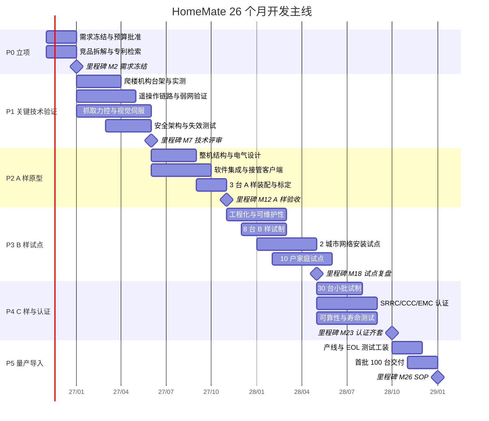

# 06 · 开发计划

> 26 个月、5 个 gate、6 个里程碑。**关键路径只有两条**：爬楼机构的可靠性，与遥操作/视觉伺服的可用性。其他都可以并行或外包。

## 一、甘特图



## 二、阶段与交付物

| 阶段 | 时间 | 月数 | 人数 | 里程碑 | 主要交付物 |
| --- | --- | ---: | ---: | --- | --- |
| P0 立项与定义 | M0–M2 | 2 | 12 | M2 需求冻结 | PRD v1.0、场景-能力矩阵、不做清单、目标成本书 |
| P1 关键技术验证 | M2–M7 | 5 | 18 | M7 技术评审 | 爬楼台架、抓取力控、遥操作链路、安全架构 四份验证报告 |
| P2 A 样原型 | M7–M12 | 5 | 20 | M12 A 样验收 | 3 台 A 样整机 + 100 项功能测试报告 |
| P3 B 样试点 | M12–M18 | 6 | 22 | M18 试点复盘 | 8 台 B 样 + 2 城市 120 单 + 10 户家庭试点 |
| P4 C 样与认证 | M18–M23 | 5 | 24 | M23 认证齐套 | 30 台 C 样 + SRRC/CCC/EMC/可靠性报告 |
| P5 量产导入 | M23–M26 | 3 | 24 | M26 SOP | 产线 + EOL 测试 + 首批 100 台 |

## 三、Gate 评审标准（不通过就不许进下一阶段）

### G1 · M2 需求冻结

- [ ] PRD v1.0 签署，含 6 个场景剧本与 12 项能力评级
- [ ] 「不做清单」7 条由项目负责人与法务共同签字
- [ ] 目标成本书：原型 ≤11 万、量产 ≤4.5 万，逐项分解到 BOM
- [ ] 专利 FTO 初筛完成，无阻塞性专利
- **不通过**：回到 P0，砍场景而不是砍标准

### G2 · M7 关键技术评审（本项目最关键的 gate）

- [ ] 爬楼：2 栋真实楼栋 ×20 次，成功率 100%，无倾覆、无打滑失控
- [ ] 抓取：已知物体 200 次，成功率 ≥95%，平均耗时 ≤25 s
- [ ] 遥操作：4G 外场端到端 P95 ≤200 ms，视频断流 ≤1 次/10 分钟
- [ ] 安全：急停 ≤100 ms、碰撞 ≤50 N 停机、断网 1 s 内停车，全部实测通过
- **不通过**：**项目降级为"园区巡检单场景版"**（投入 800 万、12 个月），先活下来

### G3 · M12 A 样验收

- [ ] 3 台 A 样整机，100 项功能测试通过率 ≥95%
- [ ] 连续运行 72 h 无致命故障
- [ ] 整备质量 ≤78 kg（超重可接受，但需给出 B 样减重方案）
- [ ] 远程接管客户端可用：一键呼叫、5 分钟内建立接管
- **不通过**：延长 P2 一个季度，不进入试点

### G4 · M18 试点复盘

- [ ] 2 城市 6 台，完成 ≥120 单真实订单，任务成功率 ≥85%
- [ ] 10 户家庭试点 ≥8 周，NPS ≥30
- [ ] 单机日均单量 ≥2.0，平均单均时长 ≤25 min
- [ ] 客户投诉率 ≤2%，无安全事故
- **不通过**：暂停 C 样，回到 P3 修产品（最多 2 次循环）

### G5 · M23 认证齐套

- [ ] SRRC、CCC/EMC、安规、电池、可靠性报告全部通过
- [ ] 500 h 连续运行无致命故障，MTBF ≥500 h
- [ ] 数据合规评估通过（隐私设计评审 + 渗透测试）
- [ ] 用户协议、说明书、警示标识齐备
- **不通过**：认证整改，量产延期，不接受"先卖后补"

## 四、关键路径

```
爬楼机构选型 ──▶ 台架 500 次 ──▶ 真实楼栋实测 ──▶ 安全认证 ──▶ 量产
   (2 周)         (6 周)          (8 周)          (12 周)
        └────────── 这条链一旦断，整个项目延期 ──────────┘

遥操作链路 ──▶ 弱网优化 ──▶ 共享控制 ──▶ 试点跑单 ──▶ 运营放大
   (3 周)       (10 周)      (12 周)      (16 周)
        └────── 这条链决定"能不能用"，而不是"能不能做" ──────
```

**两条链的共同点**：都不能靠加人加速，只能靠早开始、早暴露问题。所以 P1 阶段四条线必须**并行启动**，而不是串行。

## 五、开发方法

| 项 | 做法 |
| --- | --- |
| 硬件 | V 模型：需求 → 设计 → 台架 → 样机 → 验证，每层有评审 |
| 软件 | 双周迭代，每周可运行版本；仿真（Gazebo/Isaac）先行 |
| 集成 | 每两周一次整车集成日，问题当日归档 |
| 评审 | 双周 gate review（30 分钟，只看红黄绿）；每月复盘（2 小时） |
| 文档 | 一切进仓库：设计变更走 PR，决策走 ADR，问题走 Issue |
| 供应商 | 关键件 B 样起双源，长交期件提前 3 个月下单 |

## 六、前 90 天行动清单

| 周 | 行动 | 产出 | 责任 |
| --- | --- | --- | --- |
| W1–W2 | 立项会、预算拆分、团队组建 | 项目章程、WBS | PM |
| W1–W4 | 竞品拆解（3 款底盘 + 3 款臂 + 2 款陪护机器人） | 竞品报告 | 产品 |
| W2–W6 | 爬楼方案三选一：行星轮 / 摆臂履带 / 轮腿 | 选型报告 + 台架图纸 | 结构 |
| W2–W6 | 关键件询价（10 项，见 04 文档） | 询价对比表回填 `data/bom.csv` | 采购 |
| W3–W8 | 遥操作链路 PoC：4G 下的视频 + 控制 | 时延/卡顿实测数据 | 软件 |
| W3–W8 | 抓取 PoC：现成臂 + 深度相机做 20 次抓取 | 成功率与耗时基线 | 算法 |
| W4–W10 | 专利检索与 FTO 初筛 | FTO 意见书 | 法务 |
| W5–W10 | 安全架构设计评审（急停/抱闸/限速/围栏） | 安全设计规格书 | 系统 |
| W6–W12 | 与 2 家宽服商签试点意向书 | 试点协议（不承诺量） | BD |
| W8–W12 | 爬楼台架搭建与首轮 100 次测试 | 台架数据 | 结构 |
| W10–W12 | G1 预评审 + G2 准备 | 评审材料 | PM |

## 七、人力曲线

| 月份 | M0–M2 | M2–M7 | M7–M12 | M12–M18 | M18–M23 | M23–M26 |
| --- | ---: | ---: | ---: | ---: | ---: | ---: |
| 人数 | 12 | 18 | 20 | 22 | 24 | 24 |
| 主要增量 | — | 算法/测试 | 装配/集成 | 运营/实施 | 质量/认证 | 工艺/供应链 |

## 八、延期风险与缓冲

| 风险 | 影响 | 缓冲策略 |
| --- | --- | --- |
| 爬楼可靠性不达标 | 延期 3–6 个月 | 提前把"爬楼"做成选配模块，V1 可先不带爬楼交付 |
| 认证不通过 | 延期 3 个月 | B 样起做 EMC 预测试，预留 2 轮整改 |
| 试点单量不足 | 商业模式证伪 | 试点期同步验证"园区巡检"，B 计划切换 |
| 关键人流失 | 进度断层 | 每条线至少 2 人懂，文档强制入库 |

> 排期的可靠性不来自"排得紧"，而来自"每条主线都有 B 计划"。本计划的每个 gate 都配了不通过时的降级路径，这是它能被执行的前提。
