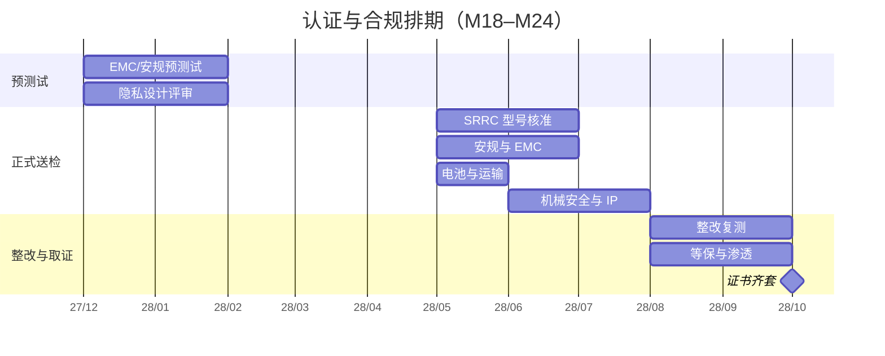

# 08 · 认证与合规

> 这一章最不"性感"，但它决定产品能不能卖、出事后公司会不会倒。
> **标准号需以现行有效版本为准**，本文写的是立项阶段的路径判断，正式送检前须由认证代理复核。

## 一、认证清单

| # | 项目 | 依据 | 适用性 | 周期 | 费用（万元） | 责任 |
| --- | --- | --- | --- | ---: | ---: | --- |
| 1 | 无线电发射设备型号核准（SRRC） | 《无线电管理条例》 | **强制**（WiFi/4G/蓝牙） | 6–8 周/型号 | 8 | 硬件 |
| 2 | 电信设备进网许可 | 工信部进网管理 | 4G 模组须已获证；整机通常不需单独申请 | — | 含在模组 | 硬件 |
| 3 | 电气安全（安规） | GB 4943.1 | 视最终产品归类，可能需 CCC 或自愿认证 | 4–6 周 | 8 | 硬件 |
| 4 | 电磁兼容（EMC） | GB/T 17626 系列等 | 强制（与安规同批） | 4–6 周 | 含上项 | 硬件 |
| 5 | 锂电池安全 | GB 31241 | **强制**（便携式锂电） | 4–6 周 | 5 | 硬件 |
| 6 | 运输安全 | UN38.3 | **强制**（空运/海运） | 2–3 周 | 含上项 | 供应链 |
| 7 | 服务机器人机械安全 | GB/T 39785 | 推荐性，但客户与保险会要 | 4–6 周 | 8 | 系统 |
| 8 | 防护等级 | GB/T 4208（IP54） | 客户要求 | 1–2 周 | 3 | 结构 |
| 9 | 可靠性/寿命 | 企业内部标准 + 委外 | 客户要求 | 8–10 周 | 12 | 质量 |
| 10 | 整改与复测 | — | 预留 2 轮 | — | 15 | 硬件 |
| 11 | 认证代理服务费 | — | — | — | 10 | 质量 |
| 12 | 云平台等保测评 | 等保 2.0 二级 | 涉及个人信息，建议做 | 8 周 | 8 | 软件 |
| 13 | 渗透测试与隐私评估 | PIPL / GB/T 35273 | 建议做 | 4 周 | 5 | 安全 |
| 14 | 其他（商标、检测杂费） | — | — | — | 8 | PM |
| | **合计** | | | **约 26 周** | **90** | |

**排期原则**：认证与 C 样**并行**，B 样就做 EMC/安规预测试。任何"C 样一次性送检"的计划都会因为一轮整改而延期 2 个月。

## 二、数据合规

家庭场景采集的是**最敏感的一类数据**：老人影像、儿童影像、居家环境、语音。一旦泄露或被认定超范围采集，后果不是罚款，是信任崩塌。

### 2.1 适用法规

| 法规 | 对我们的约束 |
| --- | --- |
| 《个人信息保护法》 | 告知同意、最小必要、单独同意（敏感个人信息）、可撤回、可删除 |
| 《数据安全法》 | 数据分级分类、出境限制、安全事件报告 |
| 《儿童个人信息网络保护规定》 | 14 岁以下需监护人同意，且不得收集与服务无关的信息 |
| GB/T 35273 个人信息安全规范 | 落地操作指引 |

### 2.2 设计对策（写进代码，不是写进 PPT）

| 要求 | 技术实现 |
| --- | --- |
| 最小必要 | 默认不录像、不录音；只传实时流，不落盘 |
| 单独同意 | 首次使用弹窗逐项勾选：视频 / 录音 / 远程接管，可分别关闭 |
| 儿童保护 | 儿童模式：不录音、不录像、不做人脸识别，仅语音对话；识别到儿童声纹自动切换 |
| 本地优先 | 人脸、声纹、跌倒检测在端侧推理，原始数据不上云 |
| 加密 | 传输 DTLS-SRTP + 应用层 AES-256；本地存储加密，密钥存 TEE |
| 可撤回/可删除 | App 内一键清空历史；7 天内彻底删除（含备份） |
| 物理断网 | 机身硬件开关，切断 4G/WiFi 并亮红灯提示 |
| 权限分级 | 家庭成员 / 远程工程师 / 客服三级，工程师权限按工单时效授予，超时自动失效 |
| 审计 | 谁在何时接管了哪台设备、看了多久，全量日志留存 6 个月 |
| 出境 | 数据不出境；海外版本单独设计 |

### 2.3 一个容易忽略的点

**远程工程师是"数据处理者"**。外包坐席如果没有保密协议、没有操作审计、没有权限时效，一旦出现偷拍或泄露，责任在品牌方。所以：工程师侧必须有**屏幕水印 + 操作留痕 + 双人复核（入室类）**。

## 三、安全责任边界

### 3.1 用户协议必须写清的 5 条

1. **定位**：本产品是"辅助工具"，不承担监护、照护、医疗职责，不能替代家人或护工。
2. **搀扶**：仅在有人监护下使用；不适用于完全失能、骨折、术后等情形；使用者须如实告知健康状况。
3. **爬楼**：仅限坡度 ≤30°、单级 ≤180mm 的楼梯；须有人在场；雨雪湿滑地面禁止使用。
4. **入室**：需业主或在场人员同意；全程录像；机器人不单独进入无人住所。
5. **数据**：默认不留存；开启录像即视为同意存储；用户可随时关闭与删除。

### 3.2 免责不等于无责

《产品质量法》下，**产品缺陷责任不能通过协议完全免除**。所以真正的兜底是三件事：

| 兜底手段 | 具体做法 |
| --- | --- |
| 设计上消除 | 固件级限制：明火/燃气/刀具场景直接拒绝执行；无监护确认拒绝搀扶 |
| 证据链 | 黑匣子日志 30 天 + 关键操作录像，事故可复盘 |
| 保险 | 产品责任险，保额 ≥1000 万元/年；试点期按台加保 |

### 3.3 保险方案（建议）

| 险种 | 保额 | 年保费（估） | 说明 |
| --- | --- | ---: | --- |
| 产品责任险 | 1000 万 | 8–15 万 | 人身伤害 + 财产损失 |
| 公众责任险 | 500 万 | 3–5 万 | 试点运营期间场所责任 |
| 网络安全责任险 | 200 万 | 2–4 万 | 数据泄露 |
| 雇主责任险 | 按人数 | 2–3 万 | 团队 |

## 四、上市前 Checklist

- [ ] SRRC 型号核准证书（整机）
- [ ] 安规 + EMC 报告（或 CCC 证书，视归类）
- [ ] 电池 GB 31241 + UN38.3 报告
- [ ] GB/T 39785 机械安全评估报告
- [ ] IP54 防护测试报告
- [ ] 可靠性报告（500h / MTBF ≥500h）
- [ ] 隐私影响评估（PIA）+ 渗透测试报告
- [ ] 等保 2.0 二级备案（云平台）
- [ ] 用户协议、隐私政策、说明书、警示标识（中文，字号合规）
- [ ] 产品责任险保单生效
- [ ] 售后与召回预案（含 48h 换机承诺）
- [ ] 固件级安全限制清单已实现并测试（明火/刀具/无监护搀扶）

## 五、时间线（与 C 样并行）

## 六、一句话总结

**认证花 90 万、6 个月，能买到"合法上市"；数据合规与责任边界的设计，买到的是"出了事还能活下来"。前者可以外包，后者只能自己做。**
